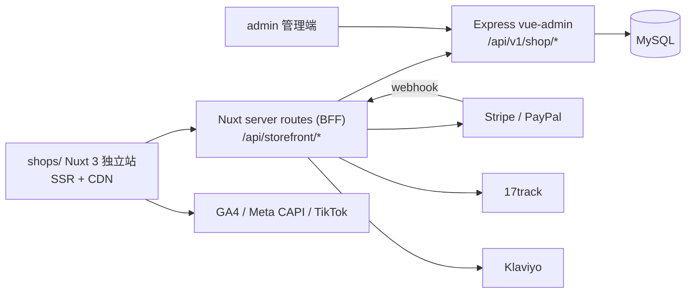

# 跨境独立站前端（shops）架构与功能设计

> **定位**：面向北美 / 欧洲市场的 C 端消费者商城（D2C 独立站）。主力品类：**假发**（高客单、内容驱动）、**服装服饰**（走量、季节性强）。
> **技术基座**：复用现有 vue-admin 后端（Express + Sequelize + MySQL）商城模块（`/api/v1/shop`），新增 Storefront 公开接口层。
> **版本**：v1.0（2026-11-04）｜关联文档：`shops/docs/API_ARCHITECTURE.md`（后台接口架构笔记）

---

## 1. 运营前提：品类与市场洞察

先说结论：**站的生命线是 SEO + 社交内容流量；转化靠信任与本地化；利润靠 AOV、弃购挽回与退货控制。** 所有功能点按这个优先级取舍。

### 1.1 品类特性 → 功能含义

| 维度 | 假发（Wigs） | 服装服饰（Apparel） |
|---|---|---|
| 客单价 | 高（$80–400） | 中低（$20–80） |
| 决策链 | 长：lace 构造 / 发质 / 纹理 / 密度 / 长度 / 色号 / 帽围 | 短，但尺码焦虑重 |
| 退货风险 | 高（卫生类目，退货标准需前置） | 高（尺码不合为主因） |
| 获客 | 网红评测 / UGC / YouTube·TikTok 驱动，SEO 长尾词丰富 | 付费广告 + 种草，季节性强 |
| 复购 | 强（护理用品、假发块、换新款） | 中（季节上新） |
| 核心人群 | 北美非裔女性为主力；欧洲多族裔 | 北美大众 + 欧洲女性 |

- **假发 → 功能要求**：专业筛选维度、重素材（视频/模特实拍/买家秀）、信任建设（真发认证、试戴、教程）重于促销。
- **服装 → 功能要求**：尺码体系（US/EU/UK 对照 + 模特数据）、色卡与材质展示、搭配推荐拉高件单。

### 1.2 欧美市场关键约束（决定 P0 功能）

| 市场要素 | 设计要求 |
|---|---|
| 获客 | Google 自然搜索为主 + TikTok/IG/Pinterest；GA4 / Meta CAPI / TikTok Pixel 第一天上齐 |
| 支付 | PayPal、信用卡（Stripe）、BNPL（Klarna/Afterpay/Sezzle）为假发品类转化标配；欧洲补本地支付（iDEAL/Bancontact） |
| 税务 | US 州销售税（economic nexus）；EU/UK VAT 含税展示 + IOSS（≤€150）；DDP 优先，降低拒收率 |
| 合规 | GDPR（EU）、CCPA（加州）、ADA/WCAG 无障碍（美国诉讼高发）、CAN-SPAM |
| 物流心智 | 免邮门槛 + 明确送达日；有海外仓时主打「本地仓 3–7 天达」（后台已支持 bonded/overseas/direct 仓库类型） |
| 信任 | 带图评价、清晰退货政策、安全支付徽章、真实客服入口，缺一不可 |

---

## 2. 总体架构

### 2.1 技术选型

| 层 | 选型 | 理由 |
|---|---|---|
| 框架 | **Nuxt 3（Vue 3 + SSR/SSG）** | 独立站 SEO 依赖服务端渲染；与现有 admin 同为 Vue3 生态，Pinia / TS / composable 心智直接复用；route rules 支持 ISR 式缓存 |
| UI | Tailwind CSS + headless 组件（reka-ui） | C 端视觉需完全自定义，不沿用 Element Plus（后台风格） |
| 状态 | Pinia + composables（useCart / useCheckout / useCurrency） | 与 admin 一致 |
| i18n | @nuxtjs/i18n（en 默认，de/fr/es/it 按流量扩展） | 多语言路由 + hreflang 内置 |
| 请求 | $fetch + Nuxt server routes（BFF） | 服务端转发 admin API：注入站点/渠道参数，密钥不出前端 |
| 支付 | Stripe（卡 / Apple Pay / Google Pay / Klarna）+ PayPal | 欧美标配；PCI 走 SAQ-A，不碰卡号 |
| 邮件/短信 | Klaviyo（邮件流）+ Attentive（US 短信） | 弃购挽回是独立站利润来源 |
| 部署 | Node SSR + Cloudflare CDN；图片 WebP/AVIF | Core Web Vitals 达标 |

> 备选：团队暂不引入 Nuxt 时，可用 Vue3 SPA + 预渲染（vite-ssg）过渡，但博客/类目页 SEO 受限，不作为首选。

### 2.2 系统关系



**关键决策**：新增 `server/modules/storefront` 公开接口模块（挂 `/api/storefront/v1`，不走 admin 鉴权），与 shop 模块共用同一套 Sequelize 模型与服务层——**不复制数据、不建第二套后端**。一个独立站 = 后台一个 channel（type=independent）+ shop 记录，天然支持未来多站点。

---
### 2.3 shops 目录结构（Nuxt 3）

```
shops/
├── nuxt.config.ts              # route rules（SSR/ISR/静态）、i18n、模块注册
├── app/
│   ├── components/             # ProductCard / VariantSelector / PriceTag / ReviewList / CartDrawer / TrustBadges …
│   ├── composables/            # useCart / useCheckout / useCurrency / useGeo / useAuth / useTracking
│   ├── layouts/                # default（头部+底部）、checkout（极简防跳出）、landing
│   ├── middleware/             # geo-currency.global.ts、auth.ts
│   ├── pages/
│   │   ├── index.vue           # 首页
│   │   ├── collections/[slug].vue
│   │   ├── products/[slug].vue
│   │   ├── search.vue
│   │   ├── cart.vue
│   │   ├── checkout/…          # 结算 + 支付结果页
│   │   ├── track/[orderNo].vue
│   │   ├── account/…           # 订单 / 地址 / 收藏 / 评价 / 退换
│   │   ├── blogs/[…slug].vue
│   │   └── pages/[slug].vue    # 政策 / CMS 页
│   ├── plugins/                # api、analytics、sentry
│   └── stores/                 # cart / user / currency / ui
├── i18n/locales/               # en-US（默认）/ de-DE / fr-FR / es-ES / it-IT
├── server/
│   └── api/                    # BFF：转发 admin API、支付 webhook、服务端 CAPI
├── shared/                     # 与 admin 共享类型（@shared）
└── tests/                      # vitest + playwright
```

### 2.4 接口复用与新增

**A. 直接复用现有接口（经 BFF 转发，加站点维度过滤）**

| 能力 | 现有接口 |
|---|---|
| 类目树 / 选项 | GET /shop/categories、/shop/categories/options |
| 品牌 | /shop/brands |
| 商品 SPU / SKU | /shop/spus、/shop/spus/:id、/shop/spus/:spuId/skus |
| 多币种价格 | /shop/skus/:skuId/prices |
| 汇率快照 | /shop/rates/snapshot |
| 库存 | /shop/inventory |
| 促销 / 优惠券 | /shop/promotions、/shop/coupons |
| 订单 | /shop/orders（+ pay / ship / cancel） |
| 仓库 | /shop/warehouses（送达日预估） |

**B. 需新增 Storefront 公开模块（server/modules/storefront，挂 /api/storefront/v1）**

| 模块 | 接口（示意） | 说明 |
|---|---|---|
| 商品浏览 | GET /sf/products、/sf/products/:slug | 仅返回 listed/published；C 端字段裁剪 + SEO 字段 |
| 顾客账户 | POST /sf/auth/register、/sf/auth/login、OAuth | C 端顾客模型独立于 admin 用户 |
| 购物车 | GET/POST /sf/cart | 服务端校验价格/库存/促销；guest 用 cartToken |
| 结算 | POST /sf/checkout/quote（运费+税）、/sf/checkout（建单+支付会话） | 复用订单模型，支付 webhook 回写 paid |
| 评价 | GET/POST /sf/reviews | 带图评价，审核后展示 |
| Q&A | GET/POST /sf/qa | 商品问答 |
| 邮件订阅 | POST /sf/newsletter | GDPR 双重确认 |
| 到货通知 | POST /sf/restock-notify | 缺货登记，回货触发 |
| 订单跟踪 | GET /sf/track/:orderNo | 对接 17track |
| 退换 | POST /sf/rma | RMA 自助申请 |
| CMS | GET /sf/cms/* | banner / 弹窗 / 博客 / 政策页 / 集合页 |
| 埋点 | POST /sf/track-event | 服务端 CAPI（Meta / Google） |

---

## 3. 站点地图与页面清单

| 页面 | 路由 | 目标 | 优先级 |
|---|---|---|---|
| 首页 | / | 品牌认知 + 爆款分流 + 订阅沉淀 | P0 |
| 类目 / 集合页 | /collections/[slug] | 筛选选品、SEO 落地页 | P0 |
| 商品详情 | /products/[slug] | 转化主战场 | P0 |
| 搜索 | /search | 意图流量承接 | P0 |
| 购物车 | /cart + mini cart | 拉高件单 | P0 |
| 结算 | /checkout | 极简防跳出（独立 layout） | P0 |
| 支付结果 | /checkout/result | 感谢页二次转化 | P0 |
| 订单跟踪 | /track/[orderNo] | 减少客服咨询 | P0 |
| 账户中心 | /account/* | 复购与售后 | P0 基础 |
| 政策页 | /pages/[slug] | 隐私 / 条款 / 退货 / 配送 | P0 |
| 博客 | /blogs/[slug] | SEO 长尾 + 内容种草 | P1 |
| 帮助中心 | /help | 自助解答 | P1 |
| 营销落地页 | /l/[slug] | 广告承接 + 活动页 | P1 |

---
## 4. 功能点清单

> 优先级：**P0** = MVP 必须；**P1** = 上线后 30–60 天；**P2** = 增长期。

### 4.1 商品浏览与商品详情

| 功能点 | 说明 | 优先级 |
|---|---|---|
| 多级类目导航 + Mega Menu | 假发按「构造 × 纹理」双入口（Lace Front / Full Lace / Headband / Wear & Go × Straight / Body Wave / Deep Wave / Curly） | P0 |
| 专业筛选器 | 假发：lace 构造、发质（人发/化纤）、纹理、密度（150/180/250%）、长度（8–40″）、色号（1B/613/Highlight…）、帽围、价格区间；服装：尺码、颜色、面料、季节、版型 | P0 |
| 排序 | 推荐 / 最新 / 价格升降 / 评分 / 销量 | P0 |
| 运营集合页 | Collections 后台可配（Bob Wigs、613 Blonde、Plus Size、黑五专场…），兼作 SEO 落地页 | P0 |
| 商品卡片 | 色卡悬停切换、评分星级、促销角标、快速加购（Quick Add） | P0 |
| 详情页信息架构 | 图库（视频+模特图+细节图）→ 变体选择 → 价格/BNPL → 库存状态 → 送达预估 → 退换摘要 → 信任徽章 → 评价 → Q&A → 搭配推荐 → 最近浏览 | P0 |
| 变体选择器 | 颜色色卡 → 长度滑条 → 密度 → lace 尺寸（13x4 / 13x6 / 5x5…），缺货变体置灰 | P0 |
| 多币种价格 | geo 自动切换 + 手动切换；复用 priceApi + rateApi；尾数定价（$XX.99） | P0 |
| 搜索 | 联想词 + 类目命中 + 空结果推荐；支持 “body wave 20 inch” 类自然语言 | P1 |
| Sticky 加购条 | 详情页滚动吸底加购 | P1 |
| 到货通知 | 缺货变体留邮箱，回货触发邮件 | P1 |
| 愿望清单 | 登录同步 + 邮件召回 | P1 |
| AR / 虚拟试戴 | 上传照片试戴假发/发色，差异化亮点 | P2 |

### 4.2 假发品类专项

| 功能点 | 说明 | 优先级 |
|---|---|---|
| 帽围测量指南 | 交互式测量引导（cm/inch），关联 SKU 帽围规格，降退货 | P0 |
| 发色色卡体系 | 1B / 2 / 4 / 27 / 613 / Highlight 等色号标准化展示 | P0 |
| 佩戴教程视频 | glueless 安装、修剪 lace 教程（详情页 + 博客联动） | P0 |
| 真发认证 / 溯源 | Brazilian / Peruvian / Vietnamese 来源标签 + 人发承诺，建信任 | P1 |
| 买家秀 UGC 墙 | 评价图聚合 + IG / TikTok 嵌入 | P1 |
| 护理套装加购 | 配件 / 护理液 / 发网组合，拉高 AOV | P1 |

### 4.3 服装品类专项

| 功能点 | 说明 | 优先级 |
|---|---|---|
| 尺码表 | US / EU / UK 对照 + cm/inch 切换 | P0 |
| 模特参考数据 | 「模特 5'8″ / 130lb 穿 S」，降低尺码焦虑 | P0 |
| 面料与洗护标签 | 成分、弹性、洗护说明 | P0 |
| Plus Size 集合 | 北美大码市场（集合页 + 筛选） | P1 |
| 尺码推荐 | 按购买历史 / 问卷推荐码数 | P2 |

### 4.4 购物车

| 功能点 | 说明 | 优先级 |
|---|---|---|
| Mini Cart 抽屉 | 加购不打断浏览 | P0 |
| 免邮进度条 | 「再买 $X 免邮」，阈值后台可配 | P0 |
| 优惠券输入 | 复用 /shop/coupons 校验（code / type / 有效期） | P0 |
| 库存联动 | 数量上限 = 可用库存，缺货实时提示 | P0 |
| 加购 Upsell | Frequently bought together / 护理套装 | P1 |
| 跨端同步 | 登录后服务端同步（guest cartToken 迁移） | P1 |

### 4.5 结算与支付

| 功能点 | 说明 | 优先级 |
|---|---|---|
| Guest Checkout | 必须支持游客下单（强制注册是转化杀手） | P0 |
| 一页式结算 | 独立极简 layout；地址自动补全（Google Places）；邮箱实时校验 | P0 |
| 配送方式 | 标准 / 加急；按国家 + 仓库给出送达日区间 | P0 |
| 税费计算 | US 销售税按州；EU/UK VAT 含税展示 + IOSS；DDP | P0 |
| 支付方式 | Stripe 卡 + Apple/Google Pay、PayPal、BNPL（Klarna/Afterpay/Sezzle，按 geo 启用）；分期文案「4 × $32.25」透出在详情页与结算页 | P0 |
| 3DS / 风控 | Stripe Radar + 3DS 自动；高风险订单后台复核 | P0 |
| 感谢页 | 订单摘要 + 复购券 + 关注社媒 + 邀请好友 | P0 |
| 弃购挽回 | 邮件序列（1h / 24h / 72h）+ Messenger/WhatsApp（US） | P1 |
| 礼品选项 / 礼品卡 | 包装、留言、礼品卡 | P2 |

---
### 4.6 履约与售后

| 功能点 | 说明 | 优先级 |
|---|---|---|
| 订单跟踪页 | 单号接入 17track，状态变化邮件订阅 | P0 |
| 订单邮件通知 | 下单 / 发货 / 签收 / 异常 | P0 |
| 自助退换（RMA） | 30 天窗口；假发卫生标准前置（lace 未裁剪、原包装）；换码互换优先于退款 | P1 |
| 帮助中心 | FAQ 分类 + 搜索 | P1 |
| 在线客服 | Tidio / 自建工单 + WhatsApp，覆盖欧美主力时区 | P1 |

### 4.7 账户中心

| 功能点 | 说明 | 优先级 |
|---|---|---|
| 注册 / 登录 | 邮箱 + 密码；magic link 免密 | P0 |
| 社交登录 | Google / Apple OAuth | P1 |
| 订单中心 | 列表 / 详情 / 再次购买 / 发票下载 | P0 |
| 地址簿 | 多地址管理 | P0 |
| 评价管理 | 我的评价 | P1 |
| 商店积分 | 忠诚度积分体系 | P2 |

### 4.8 营销与增长

| 功能点 | 说明 | 优先级 |
|---|---|---|
| 欢迎弹窗 | 首次访问订阅得 10% 券（GDPR 合规采集） | P0 |
| 促销引擎 | 复用后台 promotions（discount / full_reduce）+ 优惠券码 | P0 |
| 免邮门槛策略 | US $69+ / EU €79+（示例，按毛利测算） | P0 |
| 退出意图弹窗 | 挽留券（频次控制，防打扰） | P1 |
| Bundle / 阶梯价 | 买 2 件 9 折、3 件 8 折；假发 + 护理套装 | P1 |
| Referral 推荐 | 老带新双向券 | P1 |
| Affiliate 联盟 | 假发 KOC 分销（佣金链接 + 后台结算） | P1 |
| UGC 社交证明 | IG feed / TikTok 视频墙 / 买家秀 | P1 |
| 节日活动页 | 黑五 / 网一 / 圣诞 / 返校季模板 + 倒计时 | P1 |
| 忠诚度体系 | 积分 / 会员等级 | P2 |

### 4.9 内容与 SEO

| 功能点 | 说明 | 优先级 |
|---|---|---|
| 博客 CMS | 假发教程 / 对比 / 护理长尾内容（如 how to install lace front wig），与类目页互链 | P1 |
| 结构化数据 | Product / Review / BreadcrumbList / FAQ / Organization schema | P0 |
| Meta 管理 | 类目 / 商品 / 文章的 title、description 后台可编辑 | P0 |
| hreflang + sitemap | 多语言区域信号 + sitemap.xml 自动生成 | P0 |
| 301 / 404 | 重定向管理；404 页推荐商品 | P1 |

### 4.10 本地化（语言 / 货币 / 支付 / 税）

| 功能点 | 说明 | 优先级 |
|---|---|---|
| 语言 | en 默认；de / fr / es / it 按流量分批上线 | P0 英文 / P1 多语 |
| 货币 | USD / EUR / GBP / CAD / AUD；geo 自动 + 手动切换；汇率取后台快照，主力 SKU 手动定价覆盖 | P0 |
| 支付区域化 | US：PayPal / 卡 / Afterpay / Sezzle；EU：Klarna / iDEAL / Bancontact；UK：Klarna / Clearpay | P1 |
| 尺码 / 格式 | US / EU / UK 尺码对照；日期、地址、邮编格式本地化 | P0 |

### 4.11 合规与信任

| 功能点 | 说明 | 优先级 |
|---|---|---|
| Cookie 同意 | GDPR 弹窗 + 分级授权（EU/UK） | P0 |
| 政策页 | 隐私 / 条款 / 退货 / 配送（多语言模板） | P0 |
| 无障碍 | WCAG 2.1 AA（对比度 / 键盘导航 / alt），美国 ADA 诉讼高发 | P0 基础 |
| 数据安全 | 不存卡号（SAQ-A）；webhook 验签；日志脱敏 | P0 |
| CCPA | Do Not Sell My Info（加州） | P1 |

### 4.12 数据与埋点

| 功能点 | 说明 | 优先级 |
|---|---|---|
| 前端埋点 | GA4 + GTM；Meta Pixel、TikTok Pixel、Google Ads、Pinterest Tag | P0 |
| 标准事件 | view_item / add_to_cart / begin_checkout / add_payment_info / purchase / refund | P0 |
| 服务端 CAPI | Meta / Google 服务端事件（BFF 发送），提升归因准确 | P1 |
| UTM 归因 | 订单记录来源（site / utm），后台报表出渠道 ROI | P1 |

### 4.13 性能与质量

| 功能点 | 说明 | 优先级 |
|---|---|---|
| Core Web Vitals | LCP < 2.5s；图片 AVIF/WebP + 响应式 + 懒加载 | P0 |
| 缓存策略 | 商品 / 类目页 ISR；结算 / 账户动态 SSR | P0 |
| 监控 | Sentry（复用 admin 已有账号）+ 真实用户监控 | P0 |
| A/B 测试 | 结算 / 详情页实验 | P2 |

---

## 5. 现有后台配套扩展清单

| 扩展点 | 说明 |
|---|---|
| storefront 接口模块 | 见 2.4-B（商品浏览 / 顾客 / 购物车 / 结算 / 评价 / CMS…） |
| C 端顾客模型 | 与 admin 用户隔离的 customer 表 + 独立 JWT |
| 评价管理 | 评价审核 / 回复 / 导入（含图） |
| CMS 管理 | Banner / 弹窗 / 集合页 / 博客 / 政策页 / 落地页 |
| 站点配置 | 免邮门槛、支付开关、币种列表、政策文案、客服入口（挂到 channel/shop config） |
| 手动定价覆盖 | 按币种 × SKU 覆盖换算价（尾数定价） |
| 超卖防护 | 多渠道共享库存时下单预占（复用 inventory.locked）+ 阈值告警 |
| 弃购 / 订阅名单 | 弃购列表、newsletter 订阅导出（对接 Klaviyo） |
| 订单来源 | Order 增加 site / utm 来源字段 |

## 6. 核心指标（参考目标）

| 指标 | 参考目标（冷启动） |
|---|---|
| 转化率 | 1.5%–2.5% |
| AOV | 假发主导站点 ≥ $120（bundle + BNPL 拉动） |
| 弃购挽回率 | 10%–15% |
| 退货率 | 假发 < 8%；服装 < 15% |
| 90 天复购率 | ≥ 15% |
| 邮件收入占比 | 20%–30% 为健康 |
| 自然流量占比 | 6 个月内 ≥ 40% |

## 7. 分期路线图

| 阶段 | 周期 | 范围 |
|---|---|---|
| Phase 1 MVP | 6–8 周 | 英文 + USD 单币单语：首页 / 类目 / 详情 / 搜索 / 购物车 / 结算 / 支付 / 感谢页 / 订单跟踪 / 账户基础 / 评价展示 / 政策页 / GDPR / 像素埋点 / 基础 SEO；复用促销与优惠券 |
| Phase 2 | 4–6 周 | 多币多语、BNPL、弃购邮件流、bundle / upsell、博客、到货通知、RMA 自助、Referral / Affiliate、服务端 CAPI |
| Phase 3 | 持续 | AR 试戴、尺码推荐、忠诚度体系、A/B、个性化推荐、US/EU 分站（复用 channel/shop 多站点模型） |

## 8. 风险与依赖

| 风险 / 依赖 | 应对 |
|---|---|
| Stripe / PayPal 开户资质与周期 | 提前准备主体与银行资料；备选 Airwallex / 2Checkout |
| 汇率换算定价失真 | 主力 SKU 手动定价覆盖 + 定期核对汇率快照 |
| 多渠道超卖 | 下单预占库存（inventory.locked）+ 低库存告警 |
| 假发退货标准纠纷 | 详情页 / 结算页前置卫生退货条款，引导开箱视频 |
| 素材版权 | 模特图 / 视频授权合同；UGC 获授权后使用 |
| EU 税务合规 | IOSS 注册 + VAT 含税价展示；US economic nexus 监控 |
| 广告账号 / 像素封禁 | 服务端 CAPI + 首方数据沉淀（邮件 / 短信名单） |
